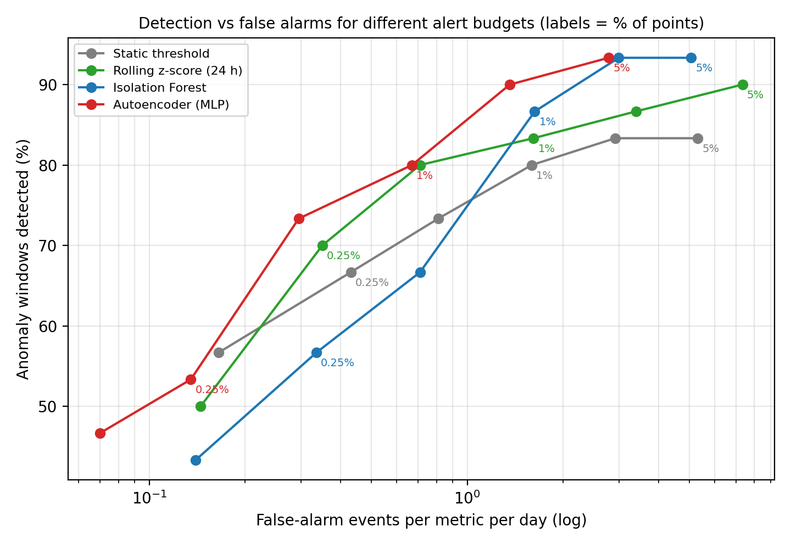
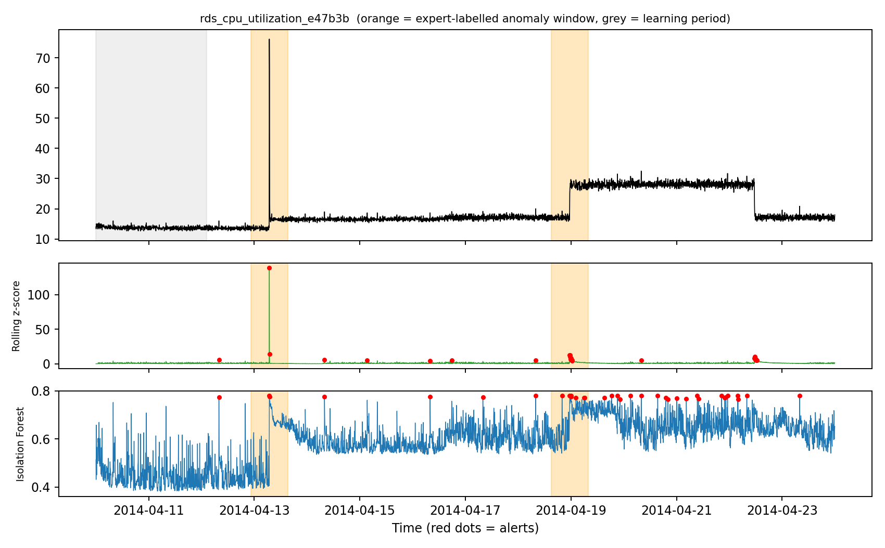

# AIOps: Unsupervised Anomaly Detection on Real AWS Cloud Server Metrics

[](https://colab.research.google.com/github/nafees-iiit/aiops-cloud-anomaly-detection/blob/main/cloud_anomaly_detection.ipynb)

Four unsupervised detectors — from a classic static alarm to a neural autoencoder — compared on
**17 real AWS CloudWatch metrics** with **expert-labelled incidents**, under realistic alert budgets.

**Author:** Mohammad Nafees, Ph.D. Scholar (ECE), MNNIT Allahabad

---

## 1. Problem

Cloud and edge servers are monitored every 5 minutes (CPU, disk, network, requests). Outages,
misconfigurations and attacks first appear as unusual behaviour in these metrics. Nobody labels
this data in real time, so detection must be **unsupervised**, and every false alarm costs an
on-call engineer's time ("alert fatigue").

## 2. Data

[Numenta Anomaly Benchmark (NAB)](https://github.com/numenta/NAB) — `realAWSCloudwatch` collection,
downloaded automatically by the script:

- 17 real metrics: EC2 CPU utilisation (8), EC2 disk writes (2), EC2 network in (3),
  ELB request count, RDS database CPU (2), auto-scaling group metric
- 67,740 data points at 5-minute resolution (≈ 2 weeks per metric)
- Expert-labelled anomaly windows — used **only for evaluation**, never for training or thresholds

## 3. Method

| Detector | Idea |
|---|---|
| Static threshold | Distance from the mean of the learning period (classic CloudWatch-style alarm) |
| Rolling z-score (24 h) | Distance from the previous 24 hours' mean and spread |
| Isolation Forest | Isolates unusual points using 5 short-term shape features |
| Autoencoder (MLP) | Neural network that rebuilds normal 1-hour windows through a 6-neuron bottleneck; poor rebuild = anomaly |

- Each detector learns only from the first 15 % of every metric (NAB learning period).
- Thresholds are set by an **alert budget** (fraction of points allowed to alarm) — no labels used.
- Alerts closer than 15 minutes are merged into one alert event.

## 4. Results (1 % alert budget, 30 scored anomaly windows)

| Detector | Windows detected | Alerts that were real incidents | False alarms per metric-day | Median alert time vs labelled anomaly (min) |
|---|---:|---:|---:|---:|
| Static threshold | 24/30 (80 %) | 27 % | 1.60 | -22 |
| Rolling z-score (24 h) | 25/30 (83 %) | 20 % | 1.62 | -160 |
| Isolation Forest | 26/30 (87 %) | 25 % | 1.63 | -12 |
| Autoencoder (MLP) | 24/30 (80 %) | 26 % | 0.67 | +0 |



**Key findings**

- At the same alert budget all detectors find **80–87 %** of incidents; the **autoencoder raises
  ~60 % fewer false-alarm events** (0.67 vs ≈ 1.6 per metric-day) because its alerts are compact.
- On the detection-vs-false-alarm curve the **autoencoder dominates**: e.g. 90 % of incidents at
  1.4 false alarms per metric-day, where the static alarm reaches 80 % at a similar cost.
- A simple static threshold is a strong baseline here — many AWS incidents are large level shifts.
- Precision stays around 20–50 %: unsupervised monitoring always trades missed incidents against alert fatigue.
- Edge deployment: the autoencoder is **23 KB** per metric vs 2.6 MB for the Isolation Forest.



More: [bar comparison](results/detector_comparison.png) · [EC2 CPU example](results/example_ec2_cpu_utilization_fe7f93.png) ·
[ELB example](results/example_elb_request_count_8c0756.png) · [all budgets](results/budget_tradeoff.csv) ·
[per-metric results](results/per_metric_results.csv)

## 5. How to run

```bash
git clone https://github.com/nafees-iiit/aiops-cloud-anomaly-detection.git
cd aiops-cloud-anomaly-detection
pip install -r requirements.txt
python cloud_anomaly_detection.py      # downloads NAB data (~2 MB) on first run
```

Or click **Open in Colab** above → **Runtime → Run all** (≈ 30 seconds).

## 6. Limitations and next steps

- Only 30 labelled windows → results have wide uncertainty; NAB windows are wide by design.
- Each metric is analysed alone; multivariate detection (CPU + network + requests together) is next.
- Next: streaming deployment as a lightweight edge agent and LSTM/Transformer forecasters.

## License

Code: MIT. Data: Numenta Anomaly Benchmark (see the NAB repository for its licence and citation).
